# Historias de Usuario - VitNota

Documento de las 20 historias de usuario del proyecto Sistema Académico (HU-001 a HU-020), organizadas en seis sprints según el diagrama PERT. Cada historia incluye su nombre, capturas tomadas de la propia aplicación VitNota y una descripción de lo que resuelve.

Las capturas corresponden a la aplicación en ejecución con los datos de demostración incluidos. Las historias HU-001 a HU-018 se ilustran con la cuenta de Administrador y las historias HU-019 y HU-020 con la cuenta de Docente. Las imágenes están en la carpeta `img/`.

## Índice

1. [Resumen de historias y sprints](#resumen-de-historias-y-sprints)
2. [HU-001: Diseño, programación e implementación de base de datos](#hu-001)
3. [HU-002: Redacción de historias de usuarios](#hu-002)
4. [HU-003: Visualizar Dashboard](#hu-003)
5. [HU-004: Registrar estudiante](#hu-004)
6. [HU-005: Editar estudiante](#hu-005)
7. [HU-006: Eliminar estudiante](#hu-006)
8. [HU-007: Buscar estudiante](#hu-007)
9. [HU-008: Ver lista de estudiantes](#hu-008)
10. [HU-009: Registrar docente](#hu-009)
11. [HU-010: Editar docente](#hu-010)
12. [HU-011: Eliminar docente](#hu-011)
13. [HU-012: Buscar docente](#hu-012)
14. [HU-013: Ver lista de docentes](#hu-013)
15. [HU-014: Registrar asignatura](#hu-014)
16. [HU-015: Editar asignatura](#hu-015)
17. [HU-016: Eliminar asignatura](#hu-016)
18. [HU-017: Buscar asignatura](#hu-017)
19. [HU-018: Ver lista de asignaturas](#hu-018)
20. [HU-019: Registrar nota](#hu-019)
21. [HU-020: Editar nota](#hu-020)

## Resumen de historias y sprints

| Sprint | Fechas | Historias |
|---|---|---|
| Sprint 1 | 10 - 15 de Agosto | HU-001 a HU-002 |
| Sprint 2 | 18 - 26 de Agosto | HU-003 a HU-005 |
| Sprint 3 | 26 de Agosto - 3 de Septiembre | HU-006 a HU-010 |
| Sprint 4 | 4 - 11 de Septiembre | HU-011 a HU-015 |
| Sprint 5 | 12 - 18 de Septiembre | HU-016 a HU-018 |
| Sprint 6 | 26 de Septiembre - 3 de Octubre | HU-019 a HU-020 |

## HU-001: Diseño, programación e implementación de base de datos

**Sprint 1** (10 - 15 de Agosto) | **Rol:** Administrador | **Módulo:** Configuración | **Caso de prueba:** CP-001

**Historia:** Como equipo de desarrollo, quiero contar con una base de datos diseñada e implementada para que el sistema almacene y consulte la información académica de forma consistente.

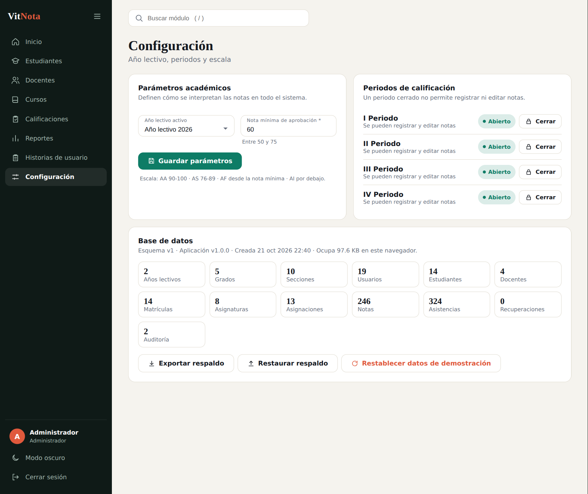

*Figura 001.1. Panel Base de datos dentro de Configuración.*

**Descripción**

VitNota guarda toda su información en una base de datos organizada en 13 tablas relacionadas entre sí: años lectivos, grados, secciones, usuarios, estudiantes, docentes, matrículas, asignaturas, asignaciones, notas, asistencias, recuperaciones y auditoría. Cada estudiante, docente, curso y nota queda enlazado con los demás mediante identificadores, de modo que una nota siempre pertenece a un estudiante matriculado y a un curso real.

La captura muestra el panel Base de datos del módulo Configuración. Allí se ve la versión del esquema, la fecha de creación, el espacio que ocupa y cuántos registros tiene cada tabla (por ejemplo 14 estudiantes, 4 docentes, 8 asignaturas y 246 notas). Desde el mismo panel el administrador puede exportar un respaldo, restaurarlo y restablecer los datos de demostración. El diseño completo de tablas y relaciones está documentado en docs/BASE-DE-DATOS.md.

[Volver al índice](#índice)

---

## HU-002: Redacción de historias de usuarios

**Sprint 1** (10 - 15 de Agosto) | **Rol:** Administrador | **Módulo:** Historias de usuario | **Caso de prueba:** CP-002

**Historia:** Como equipo de desarrollo, quiero tener las historias de usuario redactadas y organizadas para guiar el alcance, los sprints y las pruebas del proyecto.

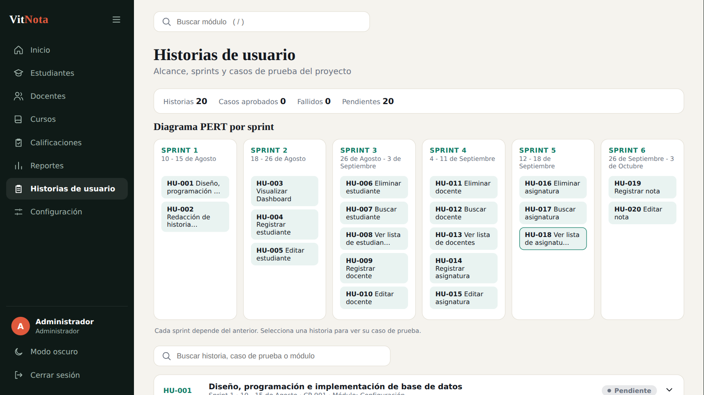

*Figura 002.1. Diagrama PERT por sprint dentro del módulo Historias de usuario.*

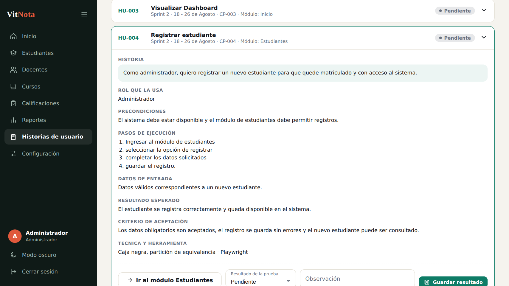

*Figura 002.2. Detalle de una historia: pasos, datos de entrada, resultado esperado y criterio de aceptación.*

**Descripción**

El módulo Historias de usuario reúne las 20 historias del proyecto. En la parte superior se muestra el diagrama PERT con los seis sprints, sus fechas y las historias que corresponden a cada uno; al seleccionar una historia, la página baja hasta su detalle.

Cada historia se despliega con su redacción (como, quiero, para), el rol que la usa, las precondiciones, los pasos de ejecución, los datos de entrada, el resultado esperado, el criterio de aceptación y la técnica de prueba. En la parte inferior de cada historia hay un botón para ir directamente al módulo que se prueba y un formulario para registrar el resultado (Pendiente, Aprobado o Fallido) con una observación, de modo que el avance de las pruebas queda guardado y visible en el diagrama.

[Volver al índice](#índice)

---

## HU-003: Visualizar Dashboard

**Sprint 2** (18 - 26 de Agosto) | **Rol:** Todos los roles | **Módulo:** Inicio | **Caso de prueba:** CP-003

**Historia:** Como usuario del sistema, quiero ver un panel de inicio con indicadores y accesos para conocer el estado académico de un vistazo según mi rol.

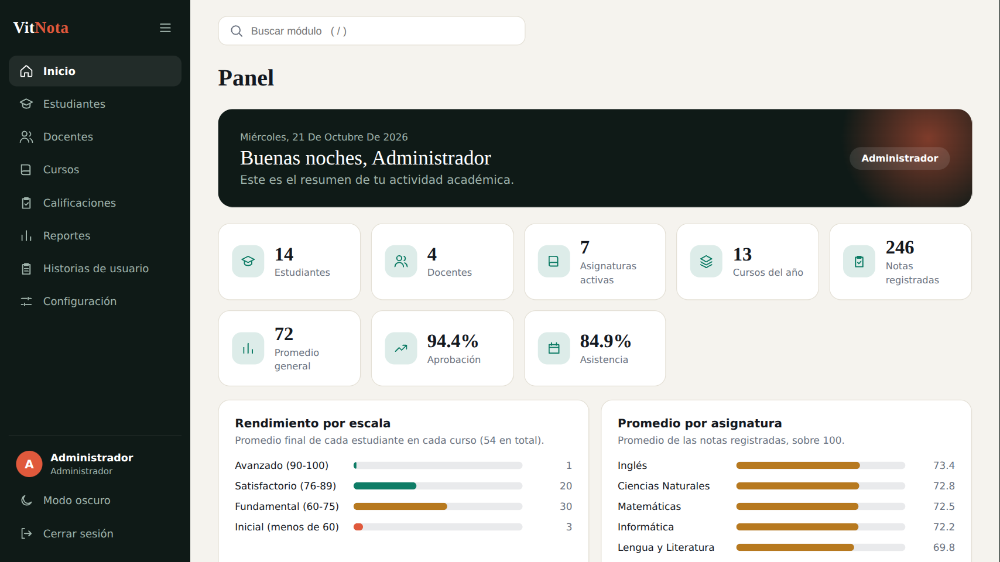

*Figura 003.1. Panel de inicio con los indicadores principales.*

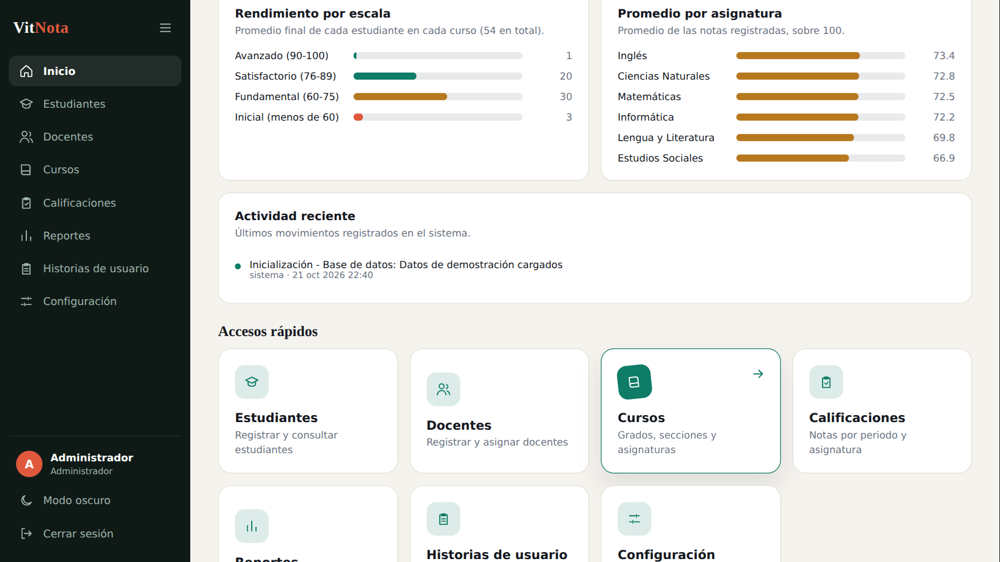

*Figura 003.2. Gráficos, actividad reciente y accesos rápidos.*

**Descripción**

El Dashboard es la primera pantalla después de iniciar sesión. Muestra un saludo, la fecha y los indicadores clave del sistema: estudiantes, docentes, asignaturas activas, cursos del año, notas registradas, promedio general, porcentaje de aprobación y porcentaje de asistencia.

Debajo aparecen los gráficos de rendimiento por escala (Avanzado, Satisfactorio, Fundamental e Inicial) y el promedio por asignatura, además de la actividad reciente y los accesos rápidos a cada módulo. Cada rol ve información propia: el administrador ve datos globales, el docente ve los de sus cursos y el estudiante ve su promedio, su asistencia y sus últimas notas.

[Volver al índice](#índice)

---

## HU-004: Registrar estudiante

**Sprint 2** (18 - 26 de Agosto) | **Rol:** Administrador | **Módulo:** Estudiantes | **Caso de prueba:** CP-004

**Historia:** Como administrador, quiero registrar un nuevo estudiante para que quede matriculado y con acceso al sistema.

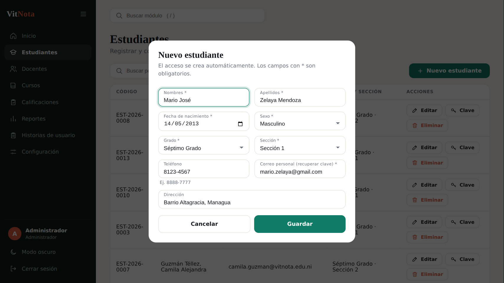

*Figura 004.1. Formulario de registro de un nuevo estudiante.*

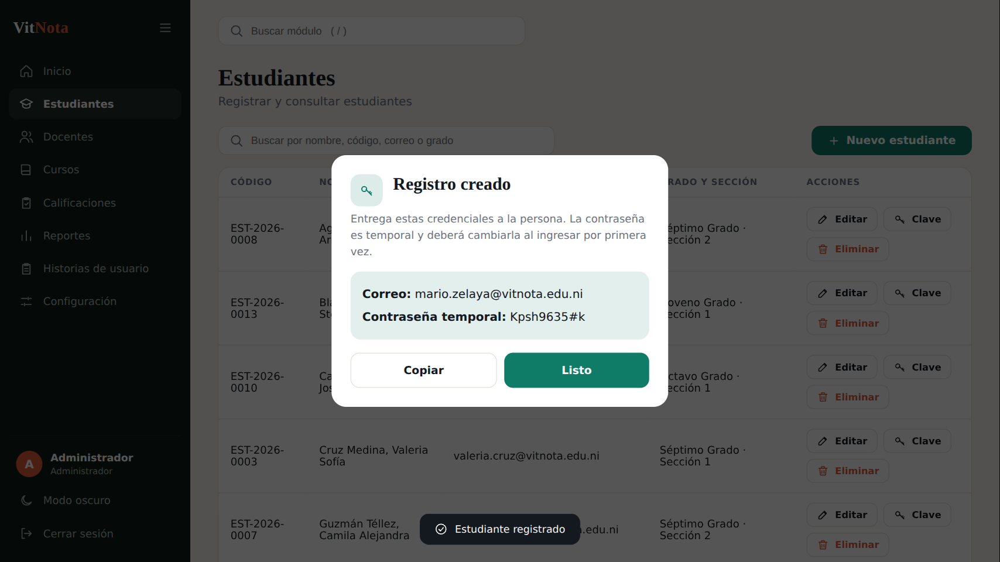

*Figura 004.2. Credenciales generadas automáticamente al registrar.*

**Descripción**

Desde el módulo Estudiantes, el botón Nuevo estudiante abre un formulario con nombres, apellidos, fecha de nacimiento, sexo, grado, sección, teléfono, correo personal y dirección. Cada campo se valida: los nombres admiten solo letras, el teléfono debe tener 8 dígitos válidos, el correo debe tener un formato correcto y la fecha de nacimiento no puede ser futura. Los errores se marcan en rojo debajo del campo correspondiente.

Al guardar, el sistema matricula al estudiante en el grado y la sección elegidos, le asigna un código (por ejemplo EST-2026-0015) y crea su acceso con un correo institucional y una contraseña temporal, que se muestran una sola vez en la segunda captura. La persona deberá cambiar esa contraseña en su primer ingreso.

[Volver al índice](#índice)

---

## HU-005: Editar estudiante

**Sprint 2** (18 - 26 de Agosto) | **Rol:** Administrador | **Módulo:** Estudiantes | **Caso de prueba:** CP-005

**Historia:** Como administrador, quiero editar los datos de un estudiante para mantener su información actualizada.

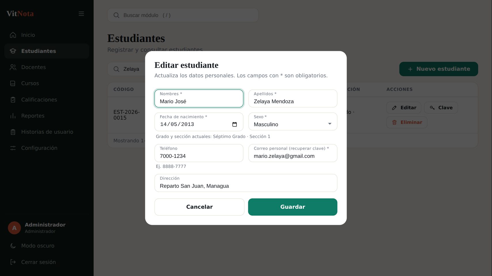

*Figura 005.1. Formulario de edición con los datos actuales.*

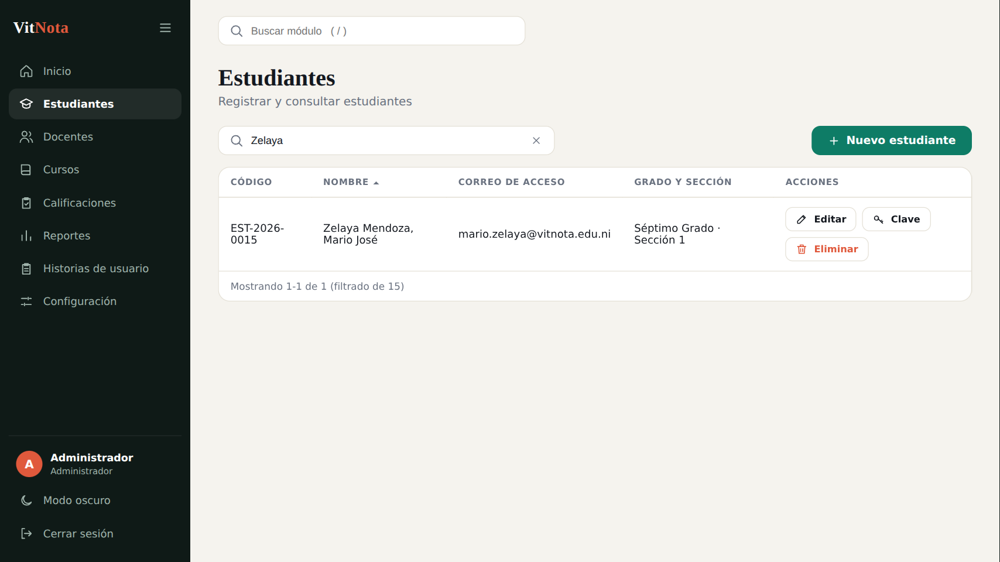

*Figura 005.2. Lista después de guardar los cambios.*

**Descripción**

El botón Editar de cada fila abre el mismo formulario con los datos actuales del estudiante. Se pueden modificar nombres, apellidos, fecha de nacimiento, sexo, teléfono, correo personal y dirección; el grado y la sección se muestran como información para no desordenar sus notas y asistencias.

Las validaciones son las mismas que al registrar, y el sistema impide repetir el correo personal de otra persona o duplicar un estudiante con los mismos nombres y fecha de nacimiento. Al guardar, la lista se actualiza y el cambio queda registrado en la actividad del sistema.

[Volver al índice](#índice)

---

## HU-006: Eliminar estudiante

**Sprint 3** (26 de Agosto - 3 de Septiembre) | **Rol:** Administrador | **Módulo:** Estudiantes | **Caso de prueba:** CP-006

**Historia:** Como administrador, quiero eliminar un estudiante para retirar registros que ya no corresponden.

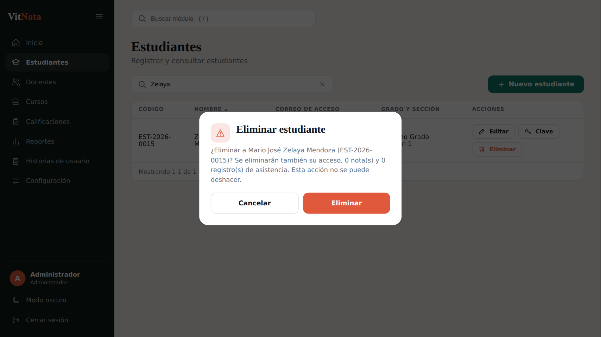

*Figura 006.1. Confirmación previa a la eliminación.*

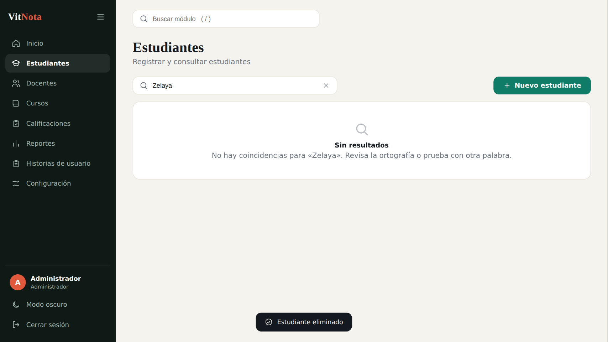

*Figura 006.2. Resultado después de confirmar la eliminación.*

**Descripción**

Al pulsar Eliminar, el sistema no borra de inmediato: abre una ventana de confirmación que indica el nombre y el código del estudiante, y cuántas notas y registros de asistencia se eliminarán junto con su acceso. La acción se puede cancelar sin consecuencias.

Si se confirma, el estudiante desaparece de la lista, se eliminan su matrícula, sus notas, su asistencia y su usuario, y aparece el aviso Estudiante eliminado. Esa persona ya no puede iniciar sesión.

[Volver al índice](#índice)

---

## HU-007: Buscar estudiante

**Sprint 3** (26 de Agosto - 3 de Septiembre) | **Rol:** Administrador | **Módulo:** Estudiantes | **Caso de prueba:** CP-007

**Historia:** Como administrador, quiero buscar un estudiante para localizarlo rápidamente por nombre, código, correo o grado.

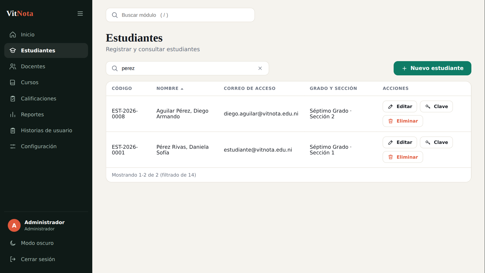

*Figura 007.1. Búsqueda por apellido sin necesidad de escribir la tilde.*

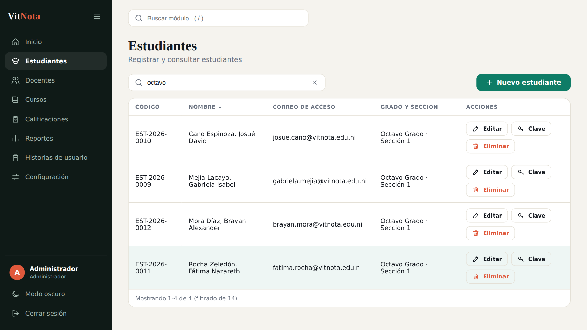

*Figura 007.2. Búsqueda por grado.*

**Descripción**

El cuadro de búsqueda de la parte superior filtra la tabla mientras se escribe. Busca en el nombre, el apellido, el código, el correo y el grado, ignora las tildes y las mayúsculas (al escribir perez aparece Pérez) y acepta varias palabras a la vez.

Debajo de la tabla se indica cuántos resultados hay respecto del total. Si no hay coincidencias se muestra el mensaje Sin resultados, y el botón con la X limpia la búsqueda.

[Volver al índice](#índice)

---

## HU-008: Ver lista de estudiantes

**Sprint 3** (26 de Agosto - 3 de Septiembre) | **Rol:** Administrador | **Módulo:** Estudiantes | **Caso de prueba:** CP-008

**Historia:** Como administrador, quiero ver la lista de estudiantes para consultar quiénes están registrados.

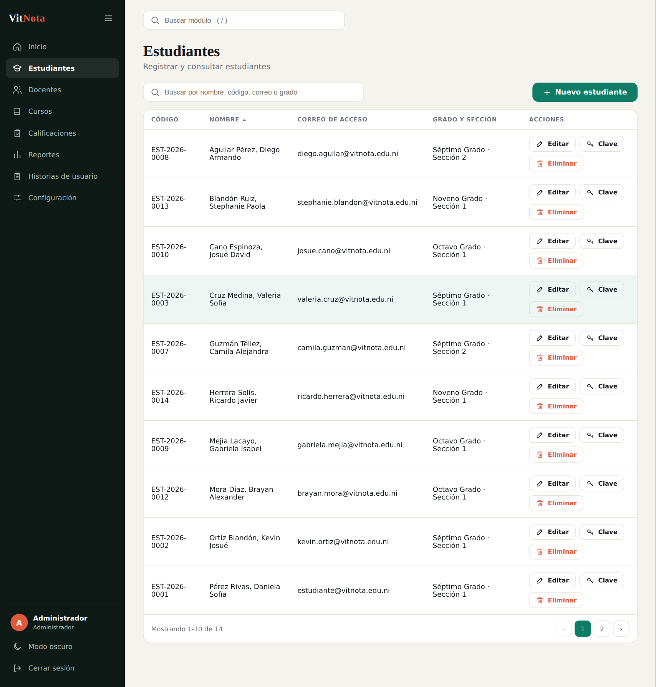

*Figura 008.1. Lista de estudiantes, página 1.*

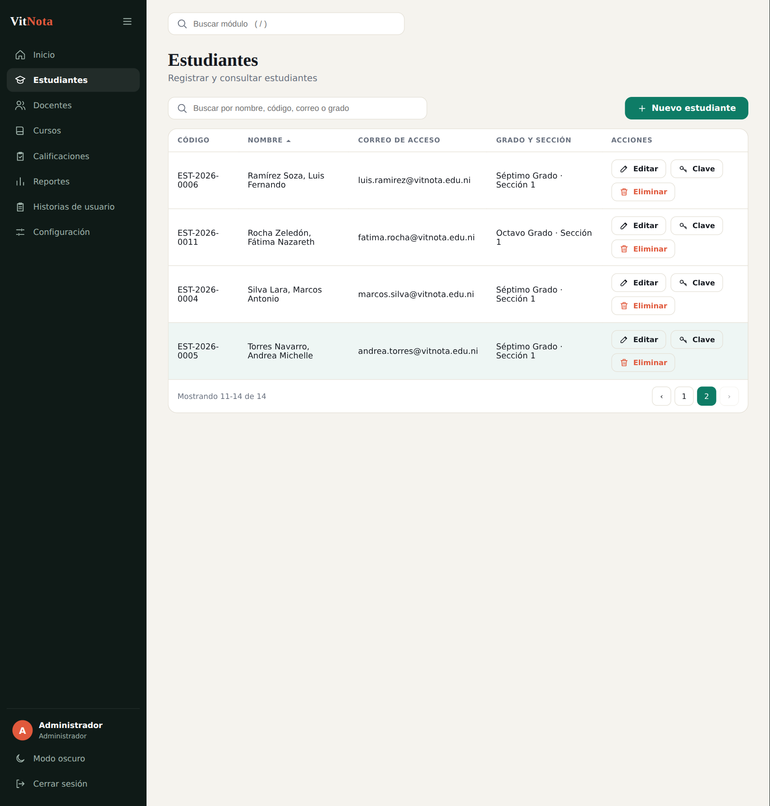

*Figura 008.2. Lista de estudiantes, página 2.*

**Descripción**

El módulo Estudiantes presenta una tabla con el código, el nombre completo, el correo de acceso y el grado y sección de cada estudiante, junto con las acciones Editar, Clave y Eliminar. Los encabezados permiten ordenar por cualquier columna.

La lista se muestra de diez en diez con paginación; en la parte inferior se indica el rango visible y el total de registros. El botón Clave genera una nueva contraseña temporal si el estudiante olvidó la suya.

[Volver al índice](#índice)

---

## HU-009: Registrar docente

**Sprint 3** (26 de Agosto - 3 de Septiembre) | **Rol:** Administrador | **Módulo:** Docentes | **Caso de prueba:** CP-009

**Historia:** Como administrador, quiero registrar un nuevo docente para que pueda recibir cursos y acceder al sistema.

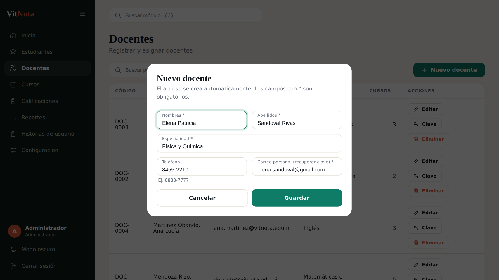

*Figura 009.1. Formulario de registro de un nuevo docente.*

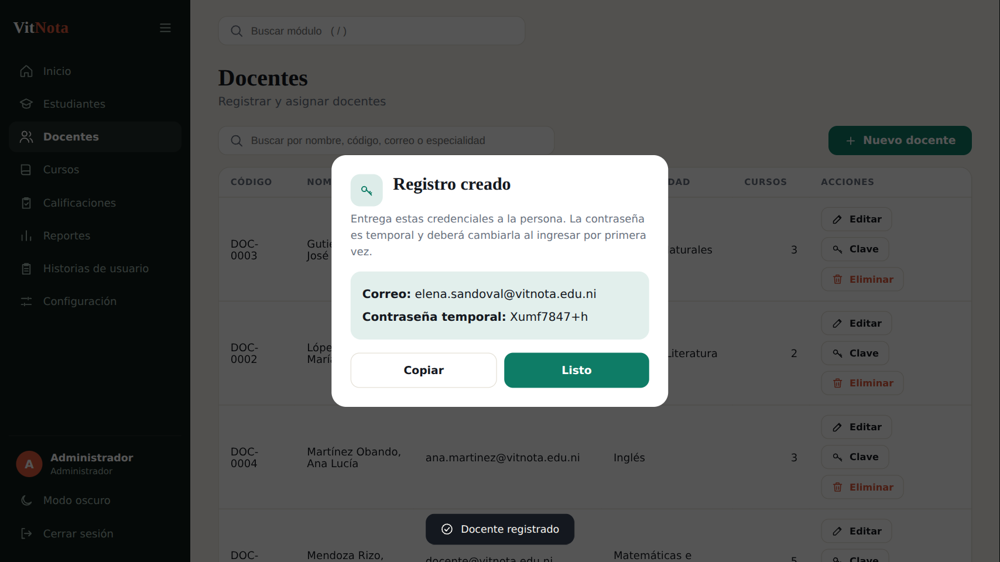

*Figura 009.2. Credenciales generadas para el docente.*

**Descripción**

En el módulo Docentes, el botón Nuevo docente abre un formulario con nombres, apellidos, especialidad, teléfono y correo personal. Nombres, apellidos, especialidad y correo personal son obligatorios, y todos los campos pasan por las mismas validaciones de formato del resto del sistema.

Al guardar se crea el docente con un código (por ejemplo DOC-0005) y su acceso con correo institucional y contraseña temporal, que se entregan en una ventana con botón para copiarlas. El docente queda disponible para asignarle cursos desde el módulo Cursos.

[Volver al índice](#índice)

---

## HU-010: Editar docente

**Sprint 3** (26 de Agosto - 3 de Septiembre) | **Rol:** Administrador | **Módulo:** Docentes | **Caso de prueba:** CP-010

**Historia:** Como administrador, quiero editar los datos de un docente para mantener su información actualizada.

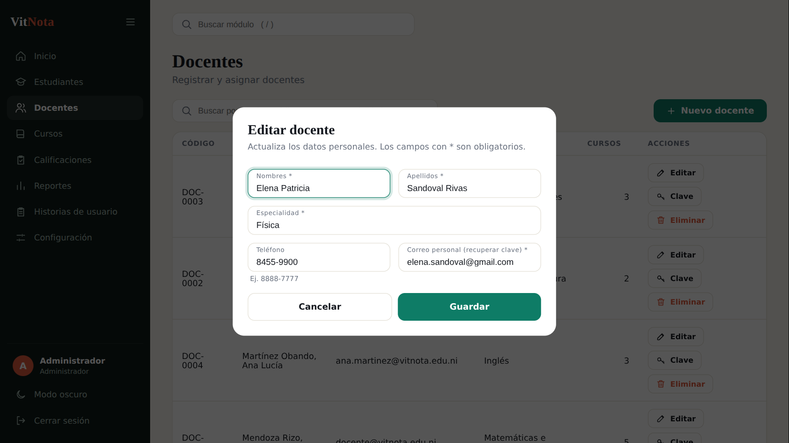

*Figura 010.1. Formulario de edición de un docente.*

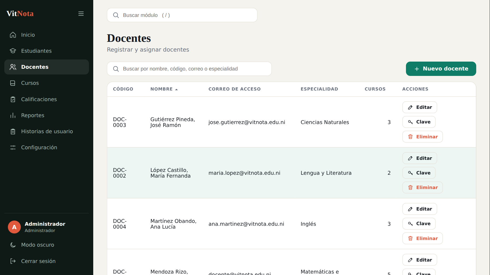

*Figura 010.2. Lista de docentes con los datos actualizados.*

**Descripción**

El botón Editar abre el formulario con los datos actuales del docente para modificar sus nombres, apellidos, especialidad, teléfono o correo personal. Se aplican las mismas validaciones que al registrar y no se permite repetir un correo personal ya usado ni duplicar un docente con el mismo nombre.

Al guardar, la tabla se actualiza con la nueva información y el movimiento queda registrado en la actividad reciente del sistema.

[Volver al índice](#índice)

---

## HU-011: Eliminar docente

**Sprint 4** (4 - 11 de Septiembre) | **Rol:** Administrador | **Módulo:** Docentes | **Caso de prueba:** CP-011

**Historia:** Como administrador, quiero eliminar un docente para retirar registros que ya no corresponden.

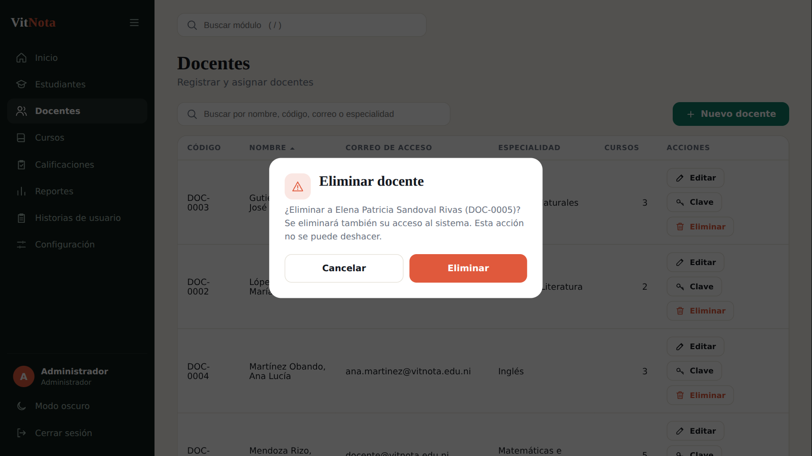

*Figura 011.1. Confirmación previa a la eliminación de un docente.*

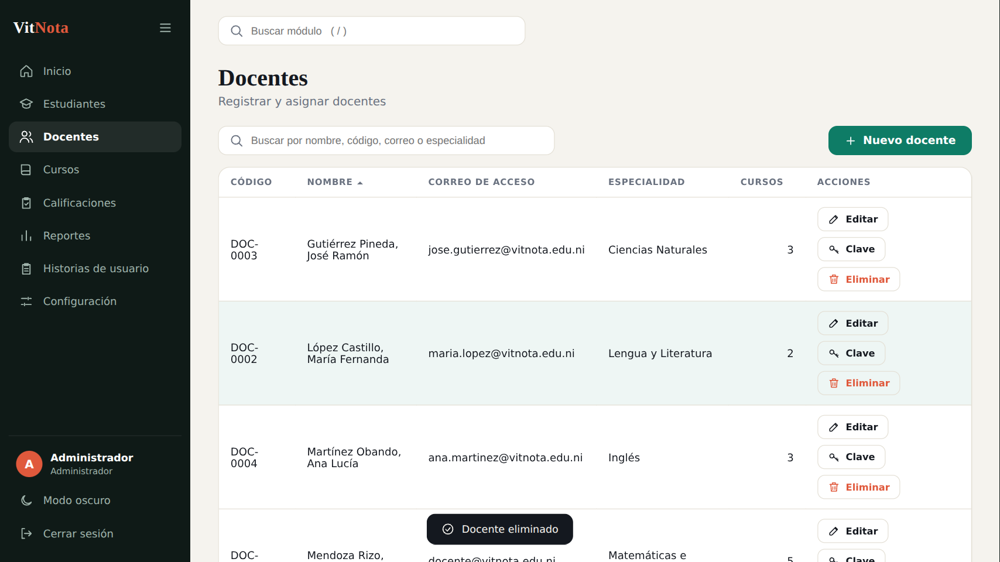

*Figura 011.2. Resultado después de confirmar.*

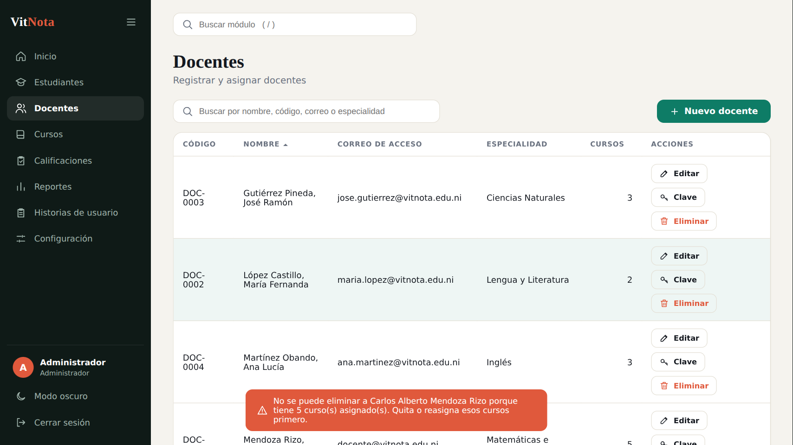

*Figura 011.3. Protección: un docente con cursos asignados no se elimina.*

**Descripción**

Eliminar un docente también pide confirmación. Si el docente no tiene cursos asignados, se elimina junto con su acceso y desaparece de la lista, como muestran las dos primeras capturas.

Para proteger la información académica, el sistema impide eliminar a un docente que tiene cursos asignados y explica el motivo con un aviso (tercera captura): primero hay que quitar o reasignar esos cursos desde el módulo Cursos.

[Volver al índice](#índice)

---

## HU-012: Buscar docente

**Sprint 4** (4 - 11 de Septiembre) | **Rol:** Administrador | **Módulo:** Docentes | **Caso de prueba:** CP-012

**Historia:** Como administrador, quiero buscar un docente para localizarlo rápidamente por nombre, código o especialidad.

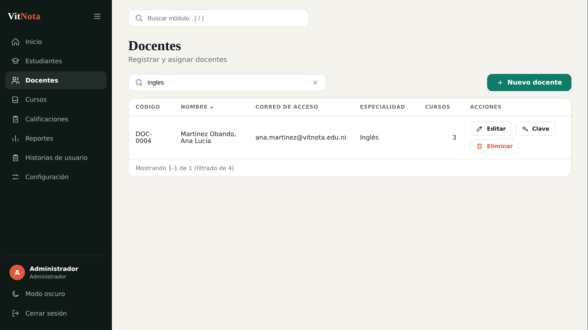

*Figura 012.1. Búsqueda de un docente por especialidad.*

**Descripción**

El buscador del módulo Docentes filtra la tabla mientras se escribe y funciona por nombre, apellido, código, correo y especialidad. En la captura se escribió ingles, sin tilde, y el sistema encontró a la docente de Inglés.

Igual que en estudiantes, la búsqueda ignora tildes y mayúsculas, indica cuántos resultados hay del total y muestra el mensaje Sin resultados cuando no hay coincidencias.

[Volver al índice](#índice)

---

## HU-013: Ver lista de docentes

**Sprint 4** (4 - 11 de Septiembre) | **Rol:** Administrador | **Módulo:** Docentes | **Caso de prueba:** CP-013

**Historia:** Como administrador, quiero ver la lista de docentes para consultar quiénes están registrados.

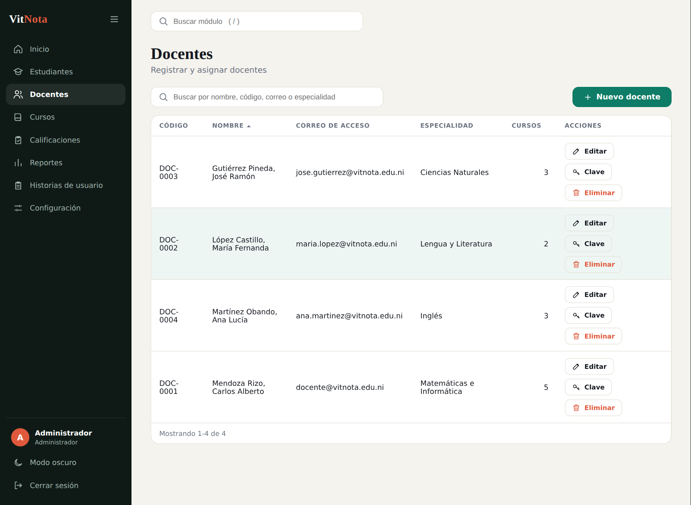

*Figura 013.1. Lista de docentes.*

**Descripción**

El módulo Docentes muestra una tabla con el código, el nombre, el correo de acceso, la especialidad y la cantidad de cursos que tiene cada docente en el año lectivo activo. Se puede ordenar por cualquier columna.

Cada fila ofrece las acciones Editar, Clave (nueva contraseña temporal) y Eliminar.

[Volver al índice](#índice)

---

## HU-014: Registrar asignatura

**Sprint 4** (4 - 11 de Septiembre) | **Rol:** Administrador | **Módulo:** Cursos | **Caso de prueba:** CP-014

**Historia:** Como administrador, quiero registrar una nueva asignatura para ofrecerla y asignarla a un docente y una sección.

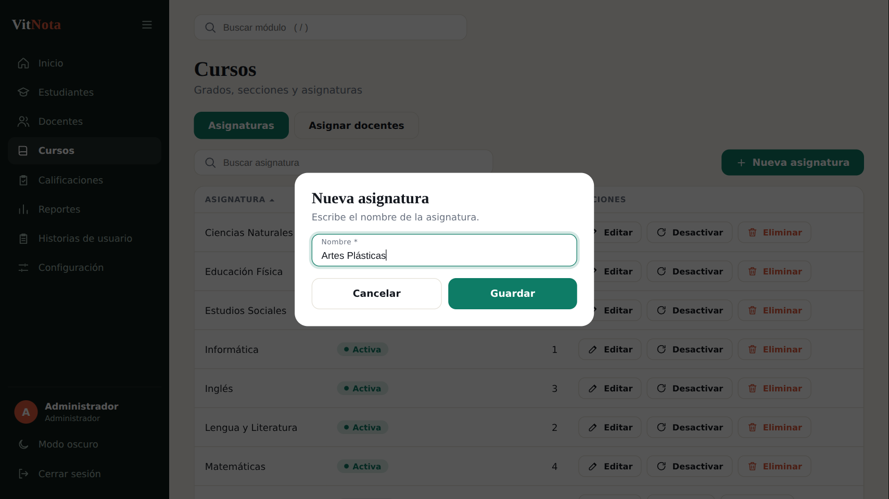

*Figura 014.1. Formulario de registro de una asignatura.*

*Figura 014.2. La asignatura aparece en el catálogo.*

**Descripción**

En Cursos, la pestaña Asignaturas muestra el catálogo y el botón Nueva asignatura abre un formulario con un solo campo: el nombre. El sistema exige entre 3 y 60 caracteres válidos y no permite repetir un nombre existente, aunque se escriba con otra tilde u otra mayúscula.

Al guardar, la asignatura queda activa en la lista y disponible en la pestaña Asignar docentes para vincularla con un docente y una sección.

[Volver al índice](#índice)

---

## HU-015: Editar asignatura

**Sprint 4** (4 - 11 de Septiembre) | **Rol:** Administrador | **Módulo:** Cursos | **Caso de prueba:** CP-015

**Historia:** Como administrador, quiero editar una asignatura para corregir su nombre o su estado.

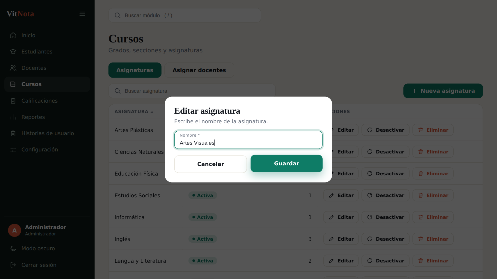

*Figura 015.1. Formulario de edición de una asignatura.*

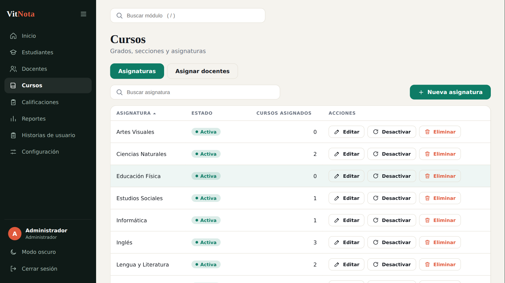

*Figura 015.2. La lista refleja el cambio.*

**Descripción**

El botón Editar permite cambiar el nombre de la asignatura con las mismas validaciones del registro. Además, el botón Desactivar o Activar cambia su estado: una asignatura inactiva se conserva en el sistema pero ya no se puede asignar a nuevos cursos.

Tras guardar, la tabla muestra el nombre actualizado.

[Volver al índice](#índice)

---

## HU-016: Eliminar asignatura

**Sprint 5** (12 - 18 de Septiembre) | **Rol:** Administrador | **Módulo:** Cursos | **Caso de prueba:** CP-016

**Historia:** Como administrador, quiero eliminar una asignatura para retirar asignaturas que no se utilizan.

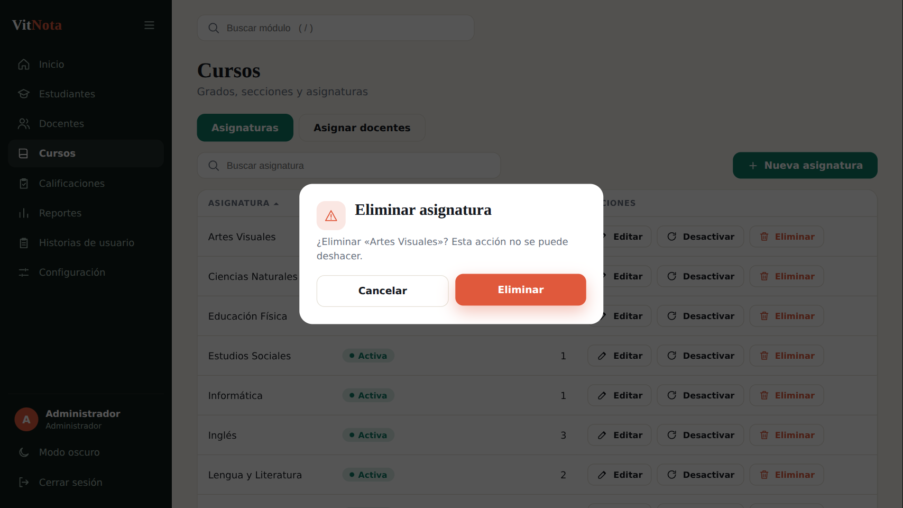

*Figura 016.1. Confirmación previa a la eliminación.*

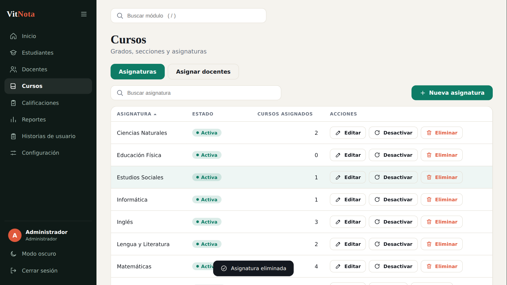

*Figura 016.2. Resultado después de confirmar la eliminación.*

**Descripción**

Al eliminar una asignatura, el sistema pide confirmación. Si la asignatura no está asignada a ningún curso se elimina y desaparece del catálogo, tal como se ve en la segunda captura.

Si ya está asignada a uno o más cursos, el sistema no la elimina y sugiere desactivarla en su lugar, para no perder el historial de notas y asistencia.

[Volver al índice](#índice)

---

## HU-017: Buscar asignatura

**Sprint 5** (12 - 18 de Septiembre) | **Rol:** Administrador | **Módulo:** Cursos | **Caso de prueba:** CP-017

**Historia:** Como administrador, quiero buscar una asignatura para localizarla rápidamente por nombre.

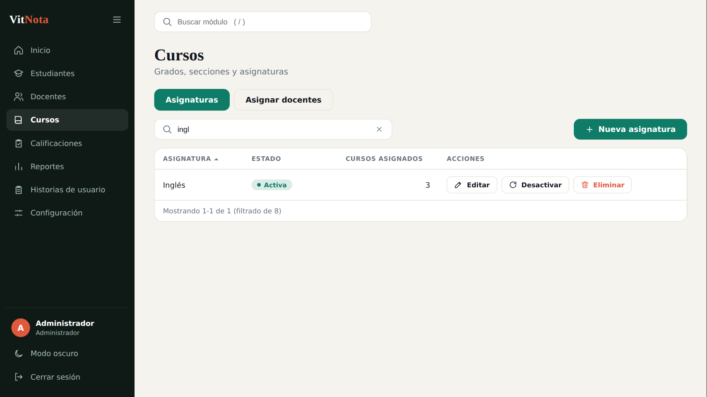

*Figura 017.1. Búsqueda de una asignatura por nombre.*

**Descripción**

La caja de búsqueda del catálogo filtra mientras se escribe, aunque solo se escriba una parte del nombre, como ingl para encontrar Inglés. También funciona por estado (activa o inactiva) e ignora tildes y mayúsculas.

Debajo de la tabla se indica cuántos resultados hay del total de asignaturas.

[Volver al índice](#índice)

---

## HU-018: Ver lista de asignaturas

**Sprint 5** (12 - 18 de Septiembre) | **Rol:** Administrador | **Módulo:** Cursos | **Caso de prueba:** CP-018

**Historia:** Como administrador, quiero ver la lista de asignaturas para consultar el catálogo completo.

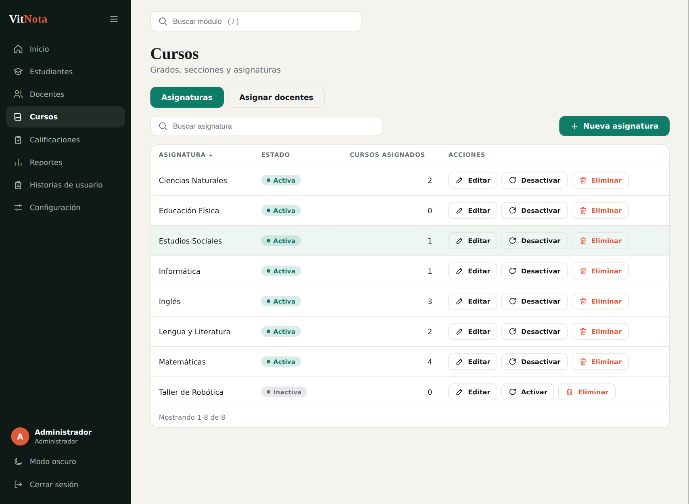

*Figura 018.1. Lista de asignaturas.*

**Descripción**

El catálogo muestra el nombre de cada asignatura, su estado (activa o inactiva) y en cuántos cursos está asignada. Las columnas se pueden ordenar y cada fila tiene las acciones Editar, Desactivar o Activar y Eliminar.

En la pestaña vecina, Asignar docentes, se vincula cada asignatura con un docente y una sección del año lectivo.

[Volver al índice](#índice)

---

## HU-019: Registrar nota

**Sprint 6** (26 de Septiembre - 3 de Octubre) | **Rol:** Docente | **Módulo:** Calificaciones | **Caso de prueba:** CP-019

**Historia:** Como docente, quiero registrar una nota de un estudiante de mis cursos para dejar constancia de su desempeño en el periodo.

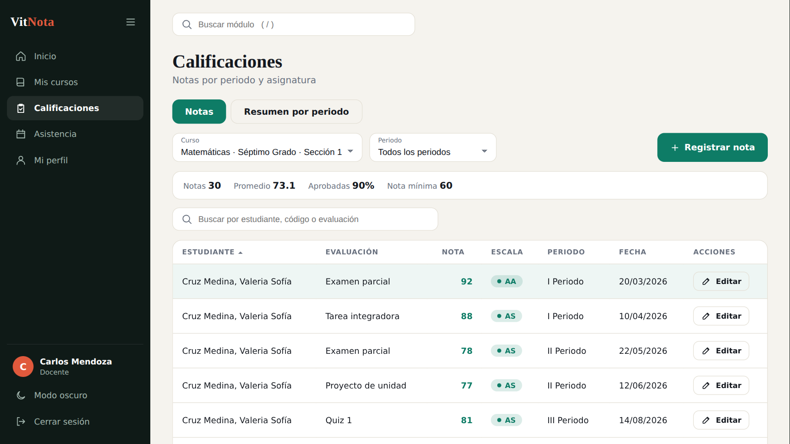

*Figura 019.1. Módulo Calificaciones con las notas del curso seleccionado.*

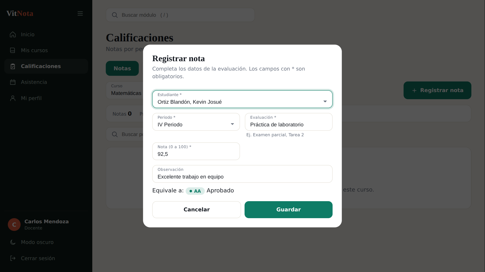

*Figura 019.2. Formulario de registro de una nota.*

*Figura 019.3. La nota aparece en la lista del periodo.*

**Descripción**

El docente entra al módulo Calificaciones, elige uno de sus cursos y, si lo desea, un periodo. La tabla muestra las notas con su estudiante, evaluación, valor, escala, periodo y fecha, junto con el total de notas, el promedio y el porcentaje de aprobadas.

El botón Registrar nota abre un formulario con el estudiante, el periodo, el nombre de la evaluación, la nota de 0 a 100 y una observación opcional. Mientras se escribe la nota, el formulario indica su equivalencia en la escala (en la captura, 92,5 equivale a AA, aprobado). El sistema rechaza notas fuera de rango, valores que no son números y evaluaciones repetidas para el mismo estudiante y periodo, y no permite registrar notas en un periodo cerrado.

[Volver al índice](#índice)

---

## HU-020: Editar nota

**Sprint 6** (26 de Septiembre - 3 de Octubre) | **Rol:** Docente | **Módulo:** Calificaciones | **Caso de prueba:** CP-020

**Historia:** Como docente, quiero editar una nota ya registrada para corregir errores mientras el periodo siga abierto.

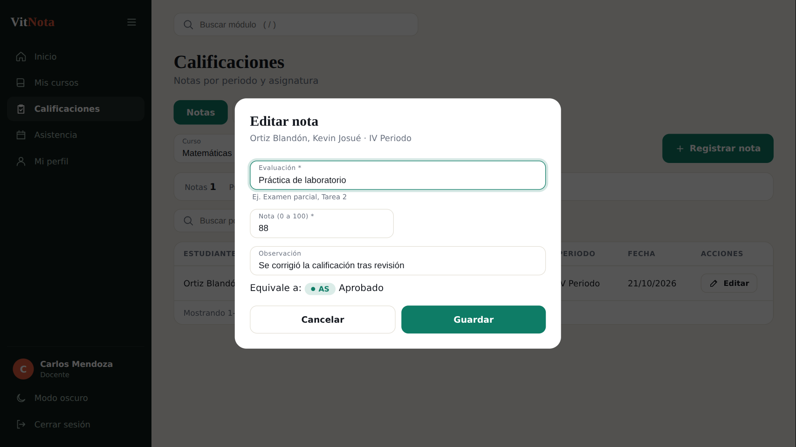

*Figura 020.1. Formulario de edición de una nota.*

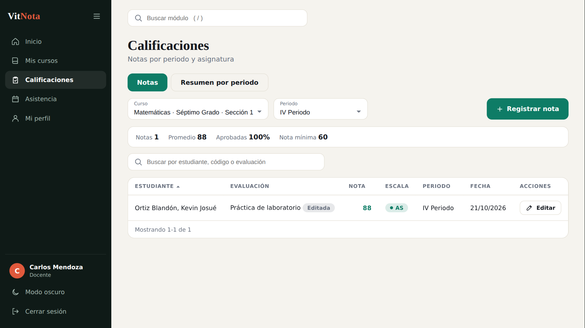

*Figura 020.2. La nota queda actualizada y marcada como Editada.*

**Descripción**

Cada nota tiene un botón Editar que abre el formulario con la evaluación, la nota y la observación. En la captura se corrige la nota de 92,5 a 88 y se agrega una observación que explica el cambio.

Al guardar, la lista muestra el nuevo valor, su escala actualizada (de AA a AS) y la etiqueta Editada junto al nombre de la evaluación. El cambio queda registrado en la actividad del sistema. Si el periodo está cerrado, en lugar del botón Editar aparece el indicador Cerrado.

[Volver al índice](#índice)

---
