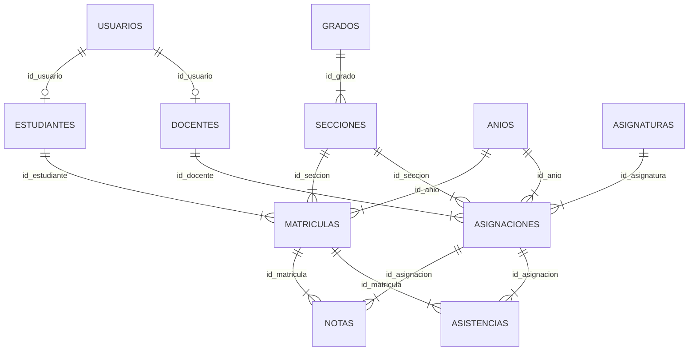

# Base de datos de VitNota (HU-001)

VitNota guarda todo en un único documento JSON dentro de `localStorage` (clave `vitnota.db.v1`). El documento está organizado en **tablas** relacionadas por **claves foráneas**, igual que lo estaría en una base relacional. Toda escritura es **atómica**: si una operación falla a mitad de camino, no se guarda nada.

## Diagrama de relaciones

## Tablas

| Tabla | Clave primaria | Campos principales |
|---|---|---|
| `anios` | `id_anio` | `nombre`, `activo` |
| `grados` | `id_grado` | `nombre_grado` |
| `secciones` | `id_seccion` | `id_grado`, `nombre_seccion`, `etiqueta` |
| `usuarios` | `id_usuario` | `nombre_usuario`, `correo` (único), `sal`, `hash`, `rol`, `debe_cambiar`, `activo`, `intentos`, `bloqueado_hasta` |
| `estudiantes` | `id_estudiante` | `id_usuario`, `codigo`, `nombres`, `apellidos`, `fecha_nacimiento`, `sexo`, `telefono`, `correo_personal`, `direccion` |
| `docentes` | `id_docente` | `id_usuario`, `codigo`, `nombres`, `apellidos`, `especialidad`, `telefono`, `correo_personal` |
| `matriculas` | `id_matricula` | `id_estudiante`, `id_seccion`, `id_anio`, `estado` |
| `asignaturas` | `id_asignatura` | `nombre` (único sin importar tildes ni mayúsculas), `estado` |
| `asignaciones` | `id_asignacion` | `id_asignatura`, `id_docente`, `id_seccion`, `id_anio` (única por asignatura + sección + año) |
| `notas` | `id_nota` | `id_matricula`, `id_asignacion`, `id_periodo`, `titulo`, `valor` (0 a 100), `observacion`, `fecha`, `registrado_por`, `modificado_por`, `fecha_modificacion` |
| `asistencias` | `id_asistencia` | `id_matricula`, `id_asignacion`, `fecha`, `estado` (Presente, Ausente, Permiso) |
| `recuperaciones` | `id_usuario` | `codigo`, `expira`, `intentos` |
| `auditoria` | `id` | `fecha`, `usuario`, `accion`, `entidad`, `detalle` (últimos 300 eventos) |

Además el documento contiene `config` (nota mínima, año activo y periodos abiertos o cerrados), `pruebas` (resultado de cada caso de prueba) y `seq` (contadores de identificadores).

## Reglas de integridad

- No se elimina un **docente** que tenga cursos asignados.
- No se elimina una **asignatura** asignada a algún curso (se puede desactivar).
- No se quita una **asignación** que ya tenga notas.
- Al eliminar un **estudiante** se eliminan también su usuario, matrícula, notas y asistencias (el sistema muestra cuántas antes de confirmar).
- El correo personal no se puede repetir entre personas.
- Una nota no puede repetir la misma evaluación para el mismo estudiante, curso y periodo.
- No se registran ni editan notas en un periodo cerrado.

## Respaldo y reinicio

En **Configuración > Base de datos** se puede exportar un respaldo JSON, restaurarlo (se valida su estructura antes de aplicarlo) o restablecer los datos de demostración.

## Paso a una base de datos real

Todas las pantallas hablan con la base a través de `VN.pedir(metodo, ruta, cuerpo)` (archivo `assets/js/api/router.js`). Para usar un servidor con SQL, sustituye esa función por un `fetch('/api/' + ruta)` con las mismas rutas; la interfaz no cambia. Los nombres de tablas y campos de este documento están pensados para mapearse uno a uno a SQL.
